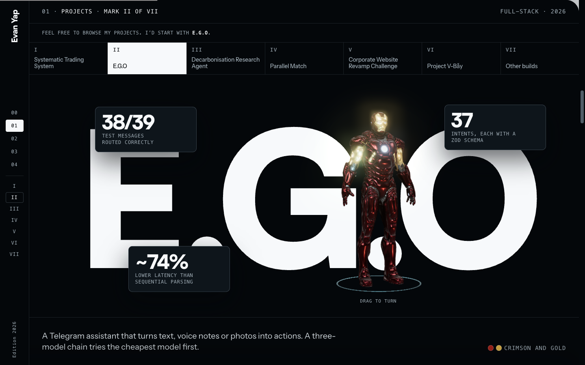

# Evan Yap: Portfolio

**Live:** <https://www.evanyap.com>

An Iron Man themed portfolio, built as **Editions**: the home page is a deck of paper sheets that slide up over a dark hero. Projects are seven suits, one per project, each a 3D model you drag to turn. Every project has its own page, and four of them (E.G.O, the research agent, Parallel Match and the Univers revamp) carry a full write-up: overview, how it works, trade-offs, evidence with its limits, my part, stack and links. Plain HTML, CSS and JavaScript as ES modules: no framework and no build step. The only npm packages are dev tools for the checks. three.js and the fonts load from CDNs. With Reduce Motion on, the scene stays but holds still.




## Highlights

- **A deck of sheets.** The hero stays put while the next sheet covers it and darkens it a little. The suit and its figures drift at their own rates. On a phone nothing floats: the opener keeps only the picker, the name and the suit, because the sheet right below repeats the figures.
- **Seven suits, seven projects.** Pick a project and the suit assembles from the code that draws it, then stands there to drag or turn with the arrow keys. A plain list of every project sits below the picker for browsers without it, and for crawlers.
- **A case study per project.** Claims are limited to what the repos show, and each page says what its numbers do not prove (a self-written eval set, synthetic data, no accuracy claim).
- **The reactor is the door.** A first visit finds the room dark ("Systems offline"). Press and hold the reactor (or hold Space on it) and it charges; at 100% the room comes up. It never opens by itself, so the resume and email stay reachable throughout.
- **A room that answers the pointer.** A shot per section that leans away from the cursor, a light that follows it and dust that parts round it.
- **Looping project diagrams** drawn as inline SVG, played only while on screen, each with a pause button.
- **Tested in the browser.** [`/tests/`](tests/) loads the site at 13 sizes (320px to 1920px) and runs about 6,600 checks: section order, heading levels, no sideways scroll, 44px tap targets, WCAG contrast, focus rings, keyboard paths, the gate, the scene, the picker and the project pages. It also runs with Reduce Motion on and with three.js blocked.

## How it was built

I designed and directed this site and built it with AI coding assistants, mainly Claude Code. The browser checks in [`/tests/`](tests/) are how I check what they write. The working notes, plans and specs from that process are kept in [`docs/superpowers/`](docs/superpowers/).

## Run it

Scripts are ES modules, so serve over HTTP:

```sh
python3 tests/serve.py 4173      # then open http://localhost:4173 (and /tests/ for the checks)
npm install                      # once: installs the git hooks and the browser-check runner
npm run check                    # JavaScript syntax, fast
npm run check:browser            # the full headless-Chrome suite, about 8 minutes
```

## Where things are

| Path | Holds |
| --- | --- |
| `index.html` | Main page: hero, About, Projects, Experience, Toolkit, Contact |
| `work/`, `case-studies/` | One page per project, and the trading agent case study |
| `css/` | `base.css` (tokens), `layout.css`, `home.css`, `editions.css` (the sheets and the Projects opener), `project.css` (project pages and the write-up styles), `figures.css`, `reactor.css`, `lab.css` |
| `js/` | `main.js` starts everything; `reactor*.js` the hero's 3D model; `gate.js`, `motion.js`, `reel.js` + `scenes.js` (diagram player) |
| `js/lab.js`, `js/scene-gl.js`, `img/scene/` | The scene: a shot per section with its depth map, drawn in depth (the camera's lean, push and travel, the reactor's light), About's spots, and the door |
| `js/marks.js`, `js/projects.js`, `js/deck.js` | The seven projects' data, the picker, and the sheets covering the hero |
| `js/suit.js`, `js/hall-*.js`, `models/hall/` | The live suit (code that forms into a 3D model) and the suit models |
| `img/`, `resume/` | Icons, logos, share image, resume PDF |

## Maintaining it

- **Email:** change `CONTACT_EMAIL` in `js/config.js`; every link and the copy button read from it.
- **Add a project:** copy a page in `work/`, add a Mark to `js/marks.js` and a card to `ul.work__grid` in `index.html`, fix the "Next project" loop, list it in `sitemap.xml`, and add it to `PAGES` in `tests/run.js` and `CARDS` in `tests/checks.js`.
- **Resume:** replace `resume/Evan-Yap-Resume.pdf`, with the phone number removed from the file itself (covering it with a box is not enough).
- **Share image:** recapture `img/og.jpg` (1200 x 630) if the hero changes.
- **Design:** one hue (`--h`, arc blue) tints the whole palette; tokens live at the top of `css/base.css`. Type is Instrument Sans, Instrument Serif (italic accents) and Satoshi (the wordmark); code and HUD labels use the system monospace.

## Deploy

Static, served by Vercel from the repo root with `cleanUrls` on. The default branch on GitHub is `tony-stark`. Vercel deploys whichever branch its project settings name as Production; other branches get previews.

## License

The code is [MIT](LICENSE). The writing, photos and resume are mine and are not covered by it.
