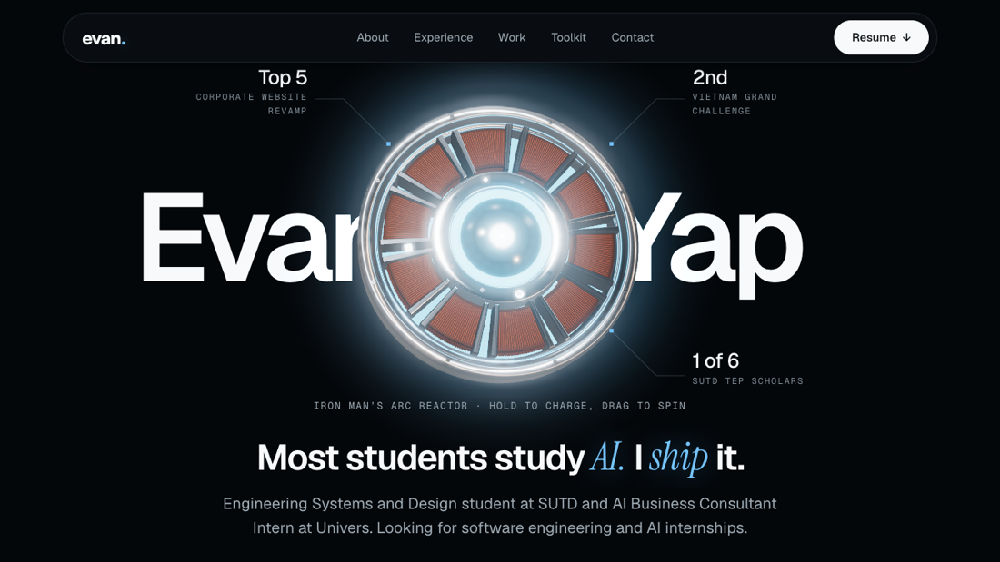

# Evan Yap: Portfolio

**Live:** <https://www.evanyap.com>

One black page in six sections (Intro, About, Experience, Selected work, Toolkit, Contact) plus a page for each project. Plain HTML, CSS and JavaScript: no framework, no build step, no dependencies.



## Highlights

- **Interactive 3D arc reactor** in three.js: powers on with a pulse, hold to charge, drag to spin, highlights follow the pointer. A still image stands in where WebGL2 is missing.
- **A way in.** A first visit opens dark ("Systems offline"). Wake it with a button, by saying "EGO" (speech recognition) or by typing it.
- **Looping project diagrams** drawn as inline SVG, played only while on screen, each with a pause button.
- **Motion with restraint.** Word-by-word title reveals, counting figures, scroll-drawn timeline, cross-page view transitions. With Reduce Motion on, nothing moves.
- **Tested in the browser.** [`/tests/`](tests/) loads the site at 13 sizes (320px to 1920px) and checks section order, heading levels, no sideways scroll, 44px tap targets, WCAG contrast, focus rings, keyboard paths and the gate.

## Run it

Scripts are ES modules, so serve over HTTP:

```sh
python3 tests/serve.py 4173      # then open http://localhost:4173 (and /tests/ for the checks)
```

## Where things are

| Path | Holds |
| --- | --- |
| `index.html` | Main page: hero, About, Experience, Selected work, Toolkit, Contact |
| `work/`, `case-studies/` | One page per project, and the trading agent case study |
| `css/` | `base.css` (tokens), `layout.css`, `home.css`, `project.css`, `figures.css`, `reactor.css` |
| `js/` | `main.js` starts everything; `reactor*.js` the 3D model; `gate.js`, `motion.js`, `reel.js` + `scenes.js` (diagram player) |
| `img/`, `resume/` | Icons, logos, share image, resume PDF |

## Maintaining it

- **Email:** change `CONTACT_EMAIL` in `js/config.js`; every link and the copy button read from it.
- **Add a project:** copy a page in `work/`, add a card to `ul.work__grid` in `index.html`, fix the "Next project" loop, and add it to `PAGES` and `CARDS` in `tests/`.
- **Resume:** replace `resume/Evan-Yap-Resume.pdf`, with the phone number removed from the file itself (covering it with a box is not enough).
- **Share image:** recapture `img/og.jpg` (1200 x 630) if the hero changes.
- **Design:** one hue (`--h`, arc blue) tints the whole palette; tokens live at the top of `css/base.css`. Type is Geist, Geist Mono, Instrument Serif and Satoshi.

## Deploy

Static, served by Vercel from the repo root with `cleanUrls` on. Pushes to `main-2` deploy to production; other branches get previews.
