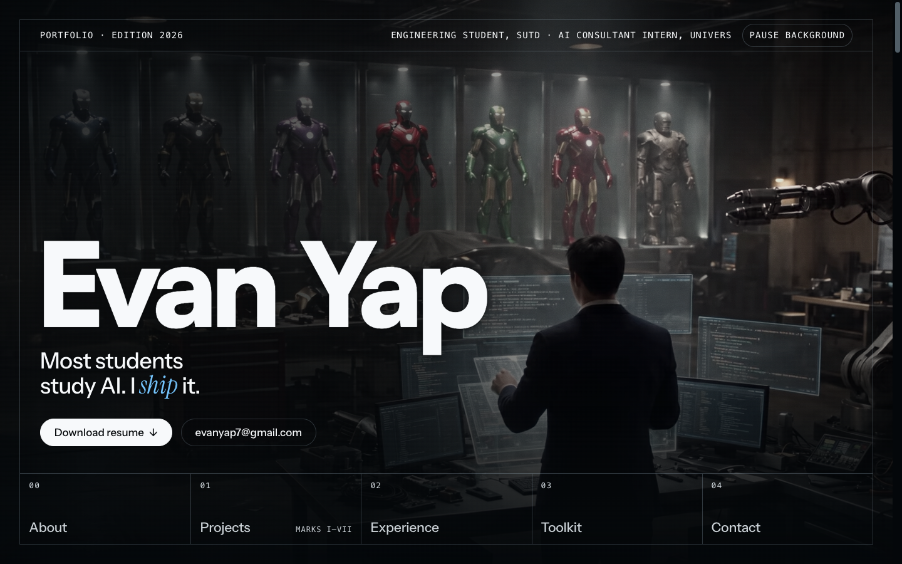
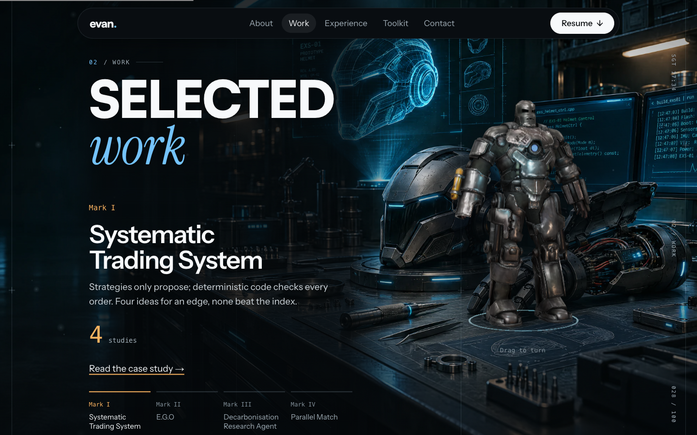

# Evan Yap: Portfolio

**Live:** <https://www.evanyap.com>

The page is **Tony Stark's workshop**. A photograph of the room sits behind the whole page, one shot per section (Intro, About, Selected work, Experience, Toolkit, Contact), and scrolling brings each shot up over the last. The shots lean away from the pointer, a light follows it, and dust hangs in the air and parts round it. There is a page for each project. Plain HTML, CSS and JavaScript as ES modules: no framework and no build step. The only npm packages are dev tools for the checks. three.js and the fonts load from CDNs. With Reduce Motion on, the scene stays but holds still.





## Highlights

- **A workshop you scroll through.** Each section has its own photograph of the room, which pushes in slowly as the section passes; the hero's is a looping clip. The reactor on the first screen is the door: a first visit finds the room dark ("Systems offline"). Press and hold the reactor (or hold Space on it) and it charges; at 100% it fires a pulse and the room comes up. It never opens by itself, so the resume and email stay reachable throughout.
- **A room that answers the pointer.** The shot leans away from it, a light follows it, the dust parts round it, and on About each hobby in the list lights its object in the photograph.
- **Interactive 3D arc reactor** in three.js: powers on with a pulse, hold to charge, drag to spin, highlights follow the pointer.
- **The Hall of Armor.** Selected work is seven Iron Man suits, each a 3D model you drag to turn, standing in the workshop beside the project it stands for.
- **Looping project diagrams** drawn as inline SVG, played only while on screen, each with a pause button.
- **Motion with restraint.** Word-by-word title reveals, counting figures, scroll-drawn timeline, cross-page view transitions. With Reduce Motion on, nothing moves.
- **Tested in the browser.** [`/tests/`](tests/) loads the site at 13 sizes (320px to 1920px) and runs about 6,500 checks: section order, heading levels, no sideways scroll, 44px tap targets, WCAG contrast, focus rings, keyboard paths, the gate, the scene and the suits.

## How it was built

I designed and directed this site and built it with AI coding assistants, mainly Claude Code. The browser checks in [`/tests/`](tests/) are how I check what they write. The working notes, plans and specs from that process are kept in [`docs/superpowers/`](docs/superpowers/).

## Run it

Scripts are ES modules, so serve over HTTP:

```sh
python3 tests/serve.py 4173      # then open http://localhost:4173 (and /tests/ for the checks)
npm install                      # once: installs the git hooks and the browser-check runner
npm run check                    # JavaScript syntax, fast
npm run check:browser            # the full headless-Chrome suite, about 8 minutes
```

## Where things are

| Path | Holds |
| --- | --- |
| `index.html` | Main page: hero, About, Experience, Selected work, Toolkit, Contact |
| `work/`, `case-studies/` | One page per project, and the trading agent case study |
| `css/` | `base.css` (tokens), `layout.css`, `home.css`, `project.css`, `figures.css`, `reactor.css` |
| `js/` | `main.js` starts everything; `reactor*.js` the hero's 3D model; `gate.js`, `motion.js`, `reel.js` + `scenes.js` (diagram player) |
| `js/lab.js`, `js/motes.js`, `img/scene/` | The scene: a shot per section, the pointer's lean and light, the dust, About's spots, and the door |
| `js/hall*.js`, `models/hall/` | The Hall of Armor: the suit picker, its stage and the suit models |
| `img/`, `resume/` | Icons, logos, share image, resume PDF |

## Maintaining it

- **Email:** change `CONTACT_EMAIL` in `js/config.js`; every link and the copy button read from it.
- **Add a project:** copy a page in `work/`, add a card to `ul.work__grid` in `index.html`, fix the "Next project" loop, list it in `sitemap.xml`, and add it to `PAGES` and `CARDS` in `tests/`.
- **Resume:** replace `resume/Evan-Yap-Resume.pdf`, with the phone number removed from the file itself (covering it with a box is not enough).
- **Share image:** recapture `img/og.jpg` (1200 x 630) if the hero changes.
- **Design:** one hue (`--h`, arc blue) tints the whole palette; tokens live at the top of `css/base.css`. Type is Instrument Sans, Instrument Serif (italic accents) and Satoshi (the wordmark); code and HUD labels use the system monospace.

## Deploy

Static, served by Vercel from the repo root with `cleanUrls` on. The default branch on GitHub is `tony-stark`. Vercel deploys whichever branch its project settings name as Production; other branches get previews.

## License

The code is [MIT](LICENSE). The writing, photos and resume are mine and are not covered by it.
